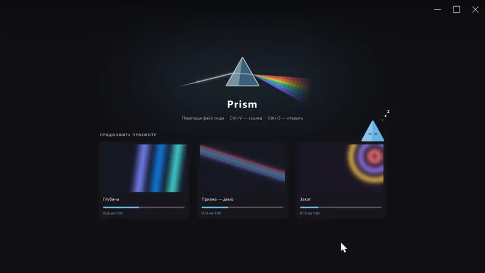
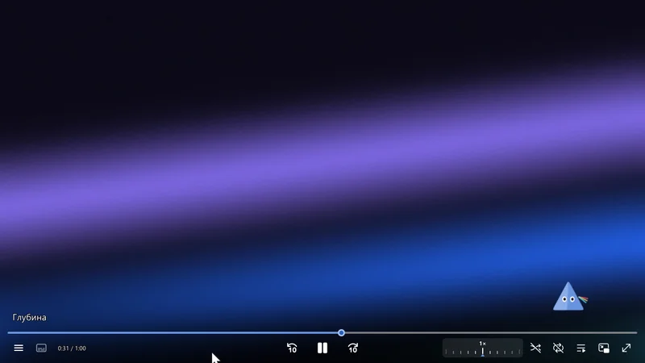

  

  <b>Одна оболочка — много граней.</b> 
  Панель управления для <a href="https://mpv.io">mpv</a>, которую можно собрать под себя мышкой — прямо в плеере.

  
  
  
  
   <a href="README.en.md">English</a> · <a href="docs/GUIDE.md">📖 Подробное руководство</a>

  

## Плеер

## Редактор

## 🚀 Установка за 3 шага

1. **Скачай** архив: [Download ZIP](https://github.com/VasiliskBRO/mpv-prism/archive/refs/heads/master.zip) и распакуй.
2. **Положи содержимое** в папку настроек mpv:
   - Windows — `portable_config` рядом с `mpv.exe` или `%APPDATA%\mpv\`;
   - Linux / macOS — `~/.config/mpv/`.
3. **Убери другие оболочки** (uosc, ModernZ и т.п.) из папки `scripts`, иначе будет две панели сразу.

Нужен **mpv 0.40+**. По желанию: **Python** — для SponsorBlock, **[streamlink](https://streamlink.github.io/)** —
для эфиров Twitch/Kick/GoodGame, **[yt-dlp](https://github.com/yt-dlp/yt-dlp)** — для видео по ссылке.

Хочешь открывать видео с сайтов в Prism одной кнопкой — **[mpv browser button](https://github.com/VasiliskBRO/mpv-browser-button)**.

## 🎮 Шпаргалка

| Хочу | Что сделать |
|---|---|
| меню | правый клик по видео (поиск — просто начни печатать) |
| открыть ссылку | скопируй её и нажми `Ctrl+V` |
| передвинуть кнопку, поменять цвет | `Ctrl+E` → тащи мышкой, правый клик — свойства → «Сохранить» |
| своё меню | `Ctrl+Shift+E` |
| другой вид панели | правый клик → «Скины» |
| вернуть как было | `Ctrl+E` → «Как по умолчанию» → «Сохранить» |

Всё остальное — в **[подробном руководстве](docs/GUIDE.md)**.

<b>⌨️ Горячие клавиши</b>

| Клавиша | Действие |
|---|---|
| Правый клик, `Menu` | главное меню |
| Двойной клик | полный экран |
| `Ctrl+E` | редактор оболочки |
| `Ctrl+Shift+E` | конструктор меню |
| `Tab` | второе меню (выбирается в «Мои меню») |
| `Alt+Q` | качество стрима / онлайн-видео |
| `Ctrl+O` / `Ctrl+H` | открыть файл / недавние |
| `Ctrl+V` / `Ctrl+Shift+V` | открыть ссылку из буфера / добавить её в плейлист |
| `Ctrl+L` | поле «Открыть ссылку…» |
| `Alt+S`, `Alt+A`, `Alt+P`, `Alt+C` | субтитры, аудио, плейлист, главы |
| `Alt+D` | аудиоустройство |
| `Ctrl+P` | картинка в картинке |
| `C` / `Shift+C` | клип: начало / сохранить в `Видео\Клипы` |
| `Alt+C` | клип за последние 30 с / 1 / 2 / 5 / 10 мин |
| `Ctrl+S` | кадр в буфер обмена |
| `Ctrl+Z` / `Ctrl+Y` | отменить / вернуть перемотку |
| `Ctrl+Alt+↑` / `↓` / `0` | окно прозрачнее / плотнее / обычное |
| `←` `→` / `↑` `↓` / колесо | перемотка 5 с / громкость |

Основные клавиши работают и в русской раскладке. Все привязки — в `input.conf`.

<b>⚙️ Настройки</b>

Всё в `script-opts/hybrid.conf` (с комментариями): тема, шаг скорости и громкости, вид паузы,
стартовый экран, хамелеон, размер «картинки в картинке» и т.д. Полный список — в начале
`scripts/hybrid/main.lua` (таблица `user_opts`). Почти всё это же можно поменять мышкой:
`Ctrl+E` → «Оформление» — и тогда настройка хранится в скине.

- `theme=prism` — фирменная тема; есть ещё `orange`, `blue`, `purple`, `green`, `red`, `pink`.
- `layout=skin` — панель из скина (`skins/*.json`), `skin=standard` — скин по умолчанию.
- `layout=default` — классическая раскладка без редактора.
- `pause_indicator=prism` — пауза через призму; `flash`, `static`, `no` — другие варианты.
- `start_screen=prism` — стартовый экран с последними видео; `mpv` — логотип mpv, `no` — пусто.
- `chameleon=yes` — цвет акцента из видео.

Внутри скрипт называется `hybrid` (папка `scripts/hybrid`, привязки `script-binding hybrid/...`) —
так сложилось исторически, на работу это не влияет.

<b>❓ Частые вопросы</b>

**Две панели сразу / панель не появляется.** В папке `scripts` осталась другая оболочка (uosc,
ModernZ, osc.lua) — убери её. На Windows mpv читает настройки и из папки рядом с `mpv.exe` — проверь обе.

**Не меняется качество стрима.** Для эфиров Twitch/Kick/GoodGame нужен streamlink, для роликов — yt-dlp.
Пункт «Качество» появляется только у стримов и видео по ссылке.

**Сломал панель в редакторе.** `Ctrl+E` → «Как по умолчанию» → «Сохранить». Или меню → «Скины» → «Стандарт».

**Иконки показываются квадратиками.** Не скопировалась папка `fonts` — положи её рядом со `scripts`.

---

## 💜 Благодарности и лицензии

- Основа панели — [ModernZ](https://github.com/Samillion/ModernZ) (LGPL-2.1), который вырос из `osc.lua` mpv.
  Громкость, линейка скорости, вспышка паузы и меню повторяют [uosc](https://github.com/tomasklaen/uosc) (LGPL-2.1).
  Остальное написано для Prism. Лицензия проекта — **LGPL-2.1** (`LICENSE`).
- [thumbfast](https://github.com/po5/thumbfast) — MPL-2.0;
  [mpv_sponsorblock](https://github.com/po5/mpv_sponsorblock) — GPL-3.0 (сообщения переведены на русский).
- `fonts/modernz-icons.ttf` — из ModernZ; `fonts/material-icons-round.otf` — Material Icons (Google, Apache-2.0).
- Видео на скриншотах сгенерировано для README (ffmpeg, фильтр `gradients`).
