# Prism — подробное руководство

[← назад к README](../README.md)

1. [Плеер](#плеер)
2. [Стартовый экран](#стартовый-экран)
3. [Пауза через призму](#пауза-через-призму)
4. [Редактор оболочки](#редактор-оболочки) — `Ctrl+E`
5. [Оформление скина](#оформление-скина)
6. [Скины: свои, экспорт и импорт](#скины-свои-экспорт-и-импорт)
7. [Конструктор меню](#конструктор-меню) — `Ctrl+Shift+E`
8. [Хамелеон](#хамелеон)
9. [Питомец](#питомец)
10. [Дополнения](#дополнения) — клипы, кадр в буфер, отмена перемотки, пропуск опенинга, прозрачность окна, Discord
11. [Кнопка в браузере](#кнопка-в-браузере) — открыть видео с сайта в Prism с того же места
12. [Свои иконки](#свои-иконки)
13. [Что где лежит](#что-где-лежит)

Горячие клавиши, настройки `hybrid.conf` и частые вопросы — в [README](../README.md).

---

## Плеер

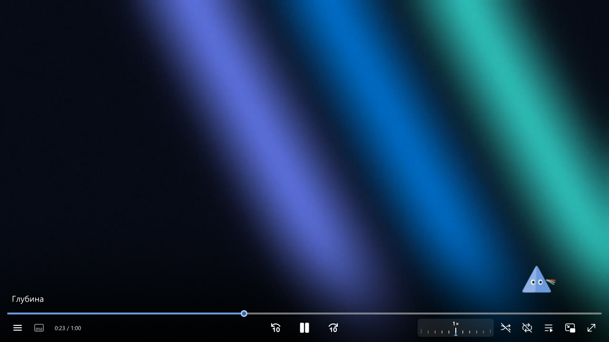

Наведи мышь вниз — появится панель: название и глава, полоса перемотки с **превью кадров** и главами,
под ней меню, субтитры, время, перемотка ±10 с, пауза, **линейка скорости**, перемешать, повтор,
плейлист, картинка в картинке, полный экран. В узком окне лишние кнопки прячутся сами.

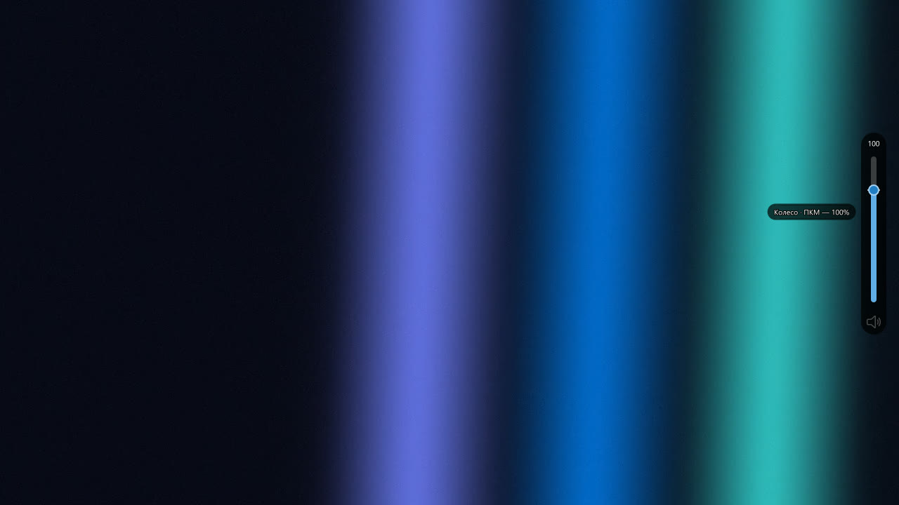

- **Громкость как в uosc** — появляется у правого края экрана; колесо над видео тоже меняет громкость.
- **Ссылки:** скопируй ссылку (YouTube, Twitch, путь к файлу) и нажми `Ctrl+V` — откроется сразу.
  `Ctrl+Shift+V` — в плейлист, `Ctrl+L` — поле «Открыть ссылку…».
- **Качество стримов** Twitch/Kick (через streamlink, без рекламы) и роликов YouTube — `Alt+Q`.
- «**Продолжено с 12:34 · С начала**» — плеер помнит, где остановился; досмотренное начинается сначала.
- **Картинка в картинке** (`Ctrl+P`), **SponsorBlock**, индикатор загрузки.

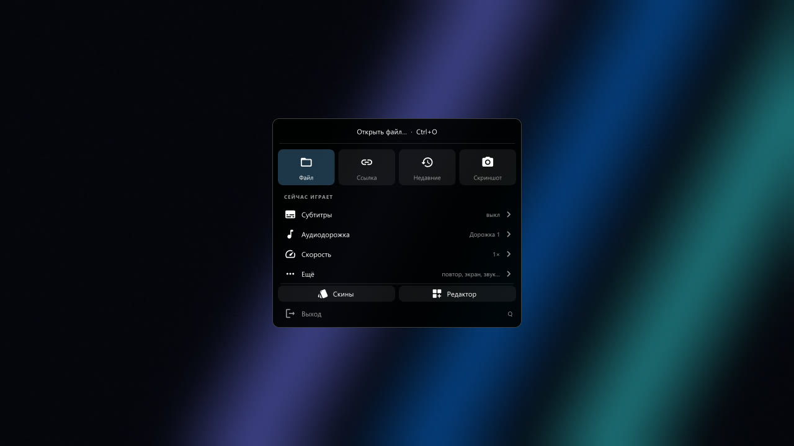

**Меню** — правый клик по видео. Сверху плитки «Файл · Ссылка · Недавние · Скриншот», ниже — только то,
что есть у этого видео (главы, субтитры, аудио, качество, скорость), редкое — в «Ещё».
Поиск — просто начни печатать. Меню можно пересобрать как угодно — см. [конструктор меню](#конструктор-меню).

## Стартовый экран

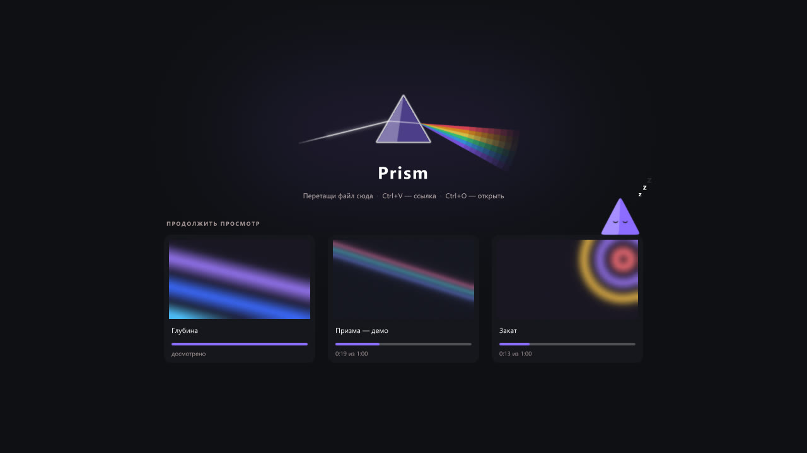

Когда ничего не играет — вместо логотипа mpv экран Prism: призма с лучом, подсказка
(перетащи файл / `Ctrl+V` — ссылка / `Ctrl+O`) и **карточки последних видео**: кадр с того места,
где остановился, название, полоска «сколько досмотрено» и «12:34 из 40:00».

- **Клик** по карточке — продолжить с того же места, **правый клик** — убрать карточку.
- Кадры и места Prism запоминает сам, когда закрываешь видео (`hybrid-recent.json` и папка
  `prism-thumbs\` в профиле). Видео, смотренные раньше, берутся из истории mpv — без кадра.
- «Недавние» → «Очистить историю» стирает и карточки.
- Настроить: `Ctrl+E` → «Оформление» → «Пауза и старт» (вид экрана, сколько карточек, кадры на них)
  или `hybrid.conf`: `start_screen=prism` / `mpv` / `no`, `start_cards=0…6`, `start_frames=yes/no`.

## Пауза через призму

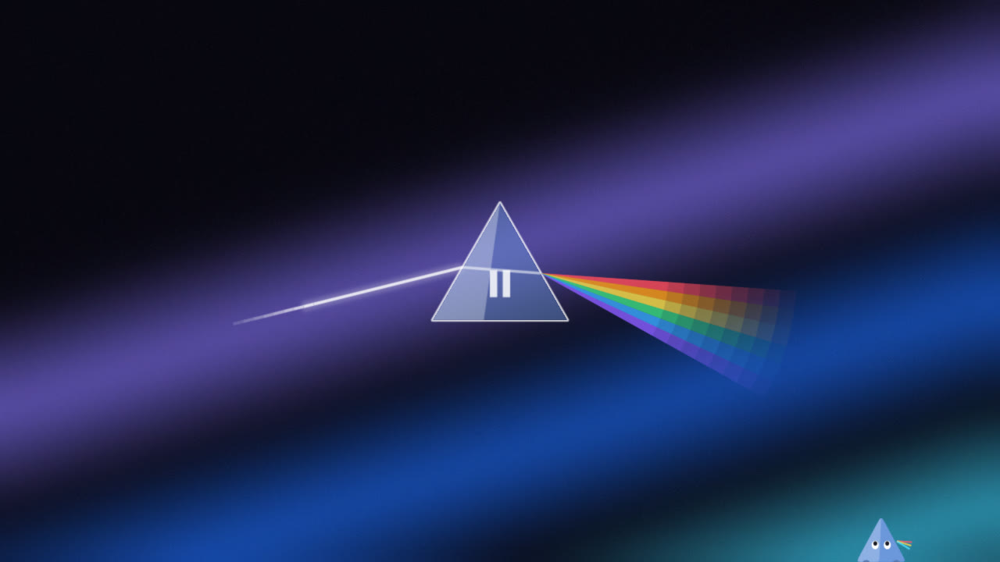

На паузе посередине появляется стеклянная призма: в неё входит белый луч, а выходит радуга.
Стекло красится цветом акцента (и хамелеоном), видео чуть темнеет. Пустил видео — всё тает.
Другой вид: `Ctrl+E` → «Оформление» → «Пауза и старт» → «Значок паузы» (призма, вспышка,
висит, нет) или `pause_indicator` в `hybrid.conf`.

## Редактор оболочки

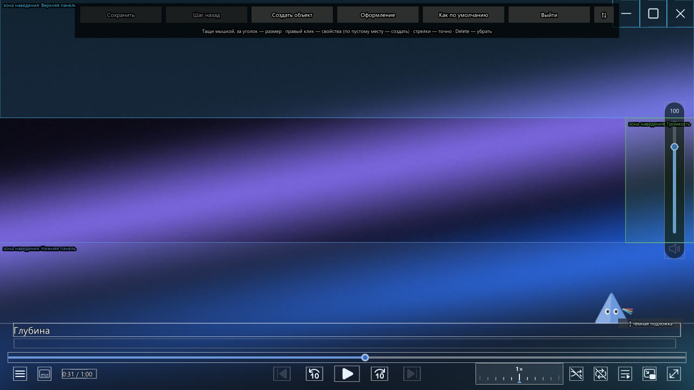

`Ctrl+E` — и панель можно править мышкой. Видео при этом на паузе.

- **Тащи** элемент — переезжает, **за уголок** — меняется размер, ручка «тёмная подложка» — высота подложки.
- **Клавиши:** стрелки — сдвиг на 1 px (Shift — на 10), `Tab` — следующий элемент, `Delete` — убрать,
  `Ctrl+Z` — шаг назад, `Ctrl+S` — сохранить. «Выйти» с несохранёнными изменениями переспросит.
- **«Как по умолчанию»** возвращает скин к исходному виду (копии в `skins/defaults/`),
  а скин, сделанный через «Новый скин», — к тому, с которого его скопировали.
- **Кнопка «⇅»** переносит панель редактора в середину экрана, чтобы не мешала ставить кнопки наверху.

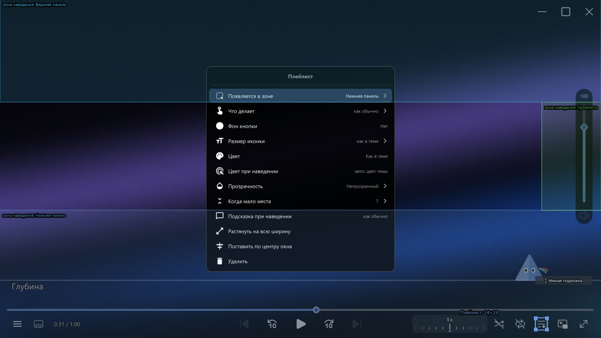

**Правый клик по элементу — свойства:** что делают левая/правая кнопка и колесо (пауза, перемотка,
следующее видео, скриншот, громкость, скорость, меню, качество… или своя команда mpv), размер иконки,
цвет, **цвет при наведении**, фон-круг, прозрачность, что прятать первым в узком окне, подсказка,
растянуть, поставить по центру, удалить.

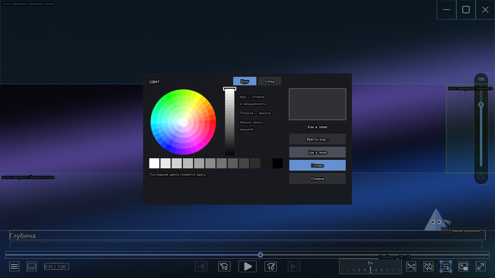

**Выбор цвета:** цветовой круг с полоской яркости (клик или перетаскивание) или сетка готовых оттенков,
серые, последние 12 цветов, «Ввести код…» (`#33FF66`). Цвет сразу виден на элементе;
«Готово» / `Enter` — оставить, «Отмена» / `Esc` — вернуть как было.

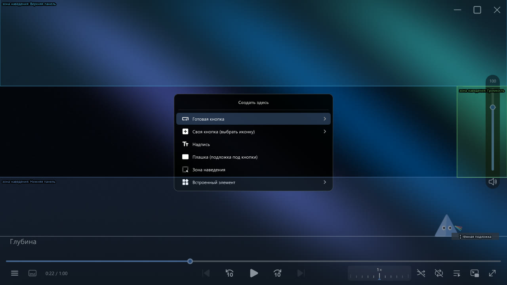

**Правый клик по пустому месту → «Создать здесь»** (или кнопка «Создать объект»): готовые кнопки
(скриншот, громче/тише, скорость 1.5×, ±30 с, главы, поверх окон, качество стрима, открыть файл…),
своя кнопка с иконкой, надпись, **плашка** (подложка под группу кнопок), **зона наведения**,
встроенные элементы.

- **Кнопки окна** (свернуть / развернуть / закрыть) и **регулятор громкости** — тоже элементы, их можно
  двигать и растягивать. Правый клик по громкости — **шкала**: максимум (100–200 %), шаг, цифра, цвет,
  вертикально или горизонтально.
- **Зоны наведения** — цветные прямоугольники: где мышь вызывает нижнюю панель, верхнюю и громкость.
  Их можно двигать и растягивать. Своя зона + у кнопки «Появляется в зоне» = кнопка, которая
  появляется сама по себе, когда мышь в этой зоне.
- Положение считается от левого края, центра или правого края окна — выбирается само, поэтому панель
  правильно растягивается при любом размере окна.

## Оформление скина

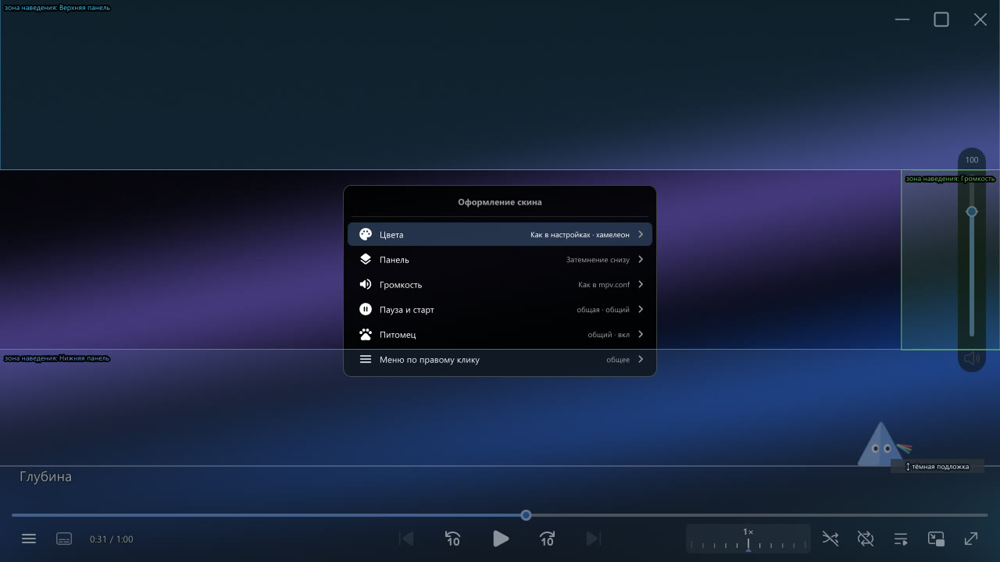

`Ctrl+E` → **«Оформление»** — всё, что относится к виду скина, разложено по папкам:

| Папка | Что внутри |
|---|---|
| **Цвета** | тема, цвет акцента (из темы или [хамелеон](#хамелеон)), цвет кружка на полосе и его обводка |
| **Панель** | подложка (затемнение, капсула, без неё), у капсулы — отступ, скругление, плотность, цвет; толщина и свечение полосы |
| **Громкость** | шкала громкости (то же, что по правому клику на регуляторе) |
| **Пауза и старт** | значок паузы, стартовый экран, карточки последних видео, кадры на них |
| **Питомец** | свой у этого скина или общий — см. [питомец](#питомец) |
| **Меню по правому клику** | своё меню у этого скина или общее |

Что в скине не задано («Как в настройках»), берётся из `hybrid.conf`.

## Скины: свои, экспорт и импорт

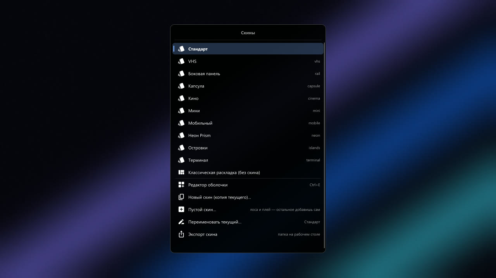

Правый клик → **«Скины»**: готовые «Стандарт», «Капсула», «Кино», «Неон Prism», «Островки», «Мини»,
«Мобильный», «VHS», «Боковая панель», «Терминал» и твои. Выбор запоминается.

- **«Новый скин»** — копия текущего, дальше правишь его в редакторе. **«Пустой скин»** — только полоса и
  кнопка паузы, остальное добавишь сам. Удалённый скин не пропадает — уезжает в `skins\archive\`.
- **Скин — это один файл** (`skins\<имя>.json`): раскладка, цвета, пауза, стартовый экран, свой питомец
  и своё меню по правому клику.
- **«Экспорт скина»** — на рабочем столе появится папка `prism-skin-<имя>`: `skin.json`, картинки, которые
  скин использует (`icons\`), его меню (`menus\`) и «Как поставить.txt». Её можно отдать другу.
- **«Импорт скина…»** — выбери `skin.json` в такой папке: скин появится в списке и включится,
  картинки и меню скопируются в профиль (существующие файлы не перезаписываются).

## Конструктор меню

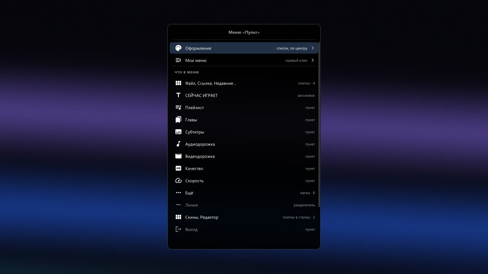

Меню по правому клику собирается из блоков. Открыть: `Ctrl+Shift+E` или правый клик → «Ещё» →
«Настроить меню…». Всё сохраняется сразу в `menus/*.json`, `Ctrl+Z` — шаг назад.

- **Блоки:** готовый пункт (их ~40), **своя кнопка с любой командой mpv**, **ряд плиток**,
  **папка** (своё подменю, вложенность любая), заголовок раздела, линия.
- **У пункта:** название, иконка, подсказка справа, цвет и **когда показывать** — когда есть смысл
  (главы — если есть главы), всегда, только при видео, только без видео.
- **Двигать:** клик по блоку → «Выше / Ниже / Переместить в…», или `Alt+↑` `Alt+↓`; `Del` — убрать.
- **Оформление:** **список или круг** вокруг курсора, где появляется (центр / у курсора / сбоку),
  ширина, высота строк, размер текста, скругление, фон, затемнение экрана, цвет выделения.
- **Круг:** наведи и кликни, или зажми правую кнопку, веди в сторону и отпусти. Начни печатать —
  круг станет списком с поиском.
- **Несколько меню:** «Мои меню» — какое открывается по правому клику, какое по `Tab`, копии,
  переименование, новые из шаблонов (Пульт, Простой список, Круг, Пустое).
- Пункт «Настроить меню…» удалить нельзя, чтобы не потерять дорогу назад.

## Хамелеон

Цвет акцента (полоса перемотки, её кружок, наведение, громкость, меню, призма на паузе) берётся
**из видео**: Prism смотрит на кадр, находит главный яркий цвет и плавно перекрашивается. В кадре без
цвета остаётся тема. Включён по умолчанию (`chameleon=yes`); скин со своей темой (Неон, VHS…) держит
свою. Настроить: «Оформление» → «Цвета» → «Цвет акцента» и «Хамелеон» (мягко / ярко, как в кадре).

## Питомец

«Призмочка» живёт на верхнем краю панели: во время просмотра сидит и моргает, на **паузе** выглядывает,
**без видео** спит на карточках стартового экрана, **в конце** машет. Красится хамелеоном.
По умолчанию выключен.

- Включить: правый клик → «Ещё» → **«Питомец»** или «Оформление» → «Питомец».
- Там же — где сидит (слева / посередине / справа), размер, «прятаться во время просмотра» и
  **своя картинка на каждое состояние** (PNG или SVG из [своих иконок](#свои-иконки)).
- Питомец бывает **общим для всех скинов** (`hybrid-pet.json`) или **своим у скина** — первая строка
  его меню: «Как во всех скинах» / «Свой у этого скина».

## Дополнения

Мелкие помощники. Каждый выключается в меню: правый клик → «Ещё» → **«Дополнения»**
(в своё меню пункт добавляется конструктором, `Ctrl+Shift+E`). Настройки — `hybrid-extras.json`.

- **Клипы.** `C` — отметить начало, `Shift+C` — сохранить кусок от начала до текущего места.
  Файл ложится в `Видео\Клипы` (папку можно сменить), сверху появится кнопка «Показать».
  «Как резать»: **быстро** — без пережатия, мгновенно, начало может сдвинуться к ближайшему ключевому кадру;
  **точно** — пережатие в MP4 (сначала видеокартой, потом процессором), пара секунд.
  Онлайн-видео (Twitch-записи, YouTube, ссылки на файлы) режет **yt-dlp**: он скачивает только этот кусок.
  **Прямой эфир Twitch** тоже режется: клип берётся из записи, которую Twitch ведёт во время стрима, и
  готов примерно через полминуты (имя — «… эфир 20.10 13-46»); точность ±1–2 с, в начале 2 с запаса.
  Не выйдет, если стример не сохраняет записи. В русской раскладке — `с` / `Shift+С`.
- **Клип за последние…** — `Alt+C`: меню «За последние 30 секунд / минуту / 2 / 5 / 10 минут», клип
  кончается на текущем моменте. В эфире Twitch кусок берётся из записи, поэтому можно взять хоть 10 минут,
  даже если в плеере столько не отмотать. Набор длин — «Дополнения» → «Длины для „последних“» (`30с, 1м, 5м`).
  Одна длина сразу, без меню, на свою клавишу: `Alt+x script-message clip-last 30` в `input.conf`.
  Пункт «Клип: последние…» есть и в конструкторе меню.
- **Кадр в буфер** — `Ctrl+S`, дальше `Ctrl+V` в Telegram / Discord. Обычный скриншот на `S` остаётся.
- **Отмена перемотки** — `Ctrl+Z` возвращает туда, откуда прыгнул, `Ctrl+Y` — обратно. Помнит 20 прыжков,
  нажатия стрелок подряд считаются одним прыжком.
- **Плейлист из папки** — открыл видео, и остальные видео из этой папки встали в очередь.
- **Пропуск** — одна кнопка **справа внизу** (над панелью, если она показана), надпись говорит, что пропустится:
  «Пропустить опенинг» / «эндинг» / «превью» — по названиям глав (Opening, OP, Intro, Ending, ED, Preview,
  «Опенинг»…; список редактируется); на эндинге, если в плейлисте есть следующее видео, — **«Следующая серия»**;
  на YouTube — «Пропустить рекламу» / «саморекламу» / «заставку»… по отрезкам SponsorBlock (сам он больше
  ничего не проматывает: `skip_categories=` в `sponsorblock.conf`). Нажать — мышью или `Enter`; полоска по низу
  кнопки показывает, сколько она ещё провисит. Если справа сидит питомец, кнопка встаёт вплотную к нему, а он
  машет (или выглядывает из-за края). Режимы: кнопка, пропускать сам, выключено.
- **Прозрачность окна** — `Ctrl+Alt+↑` прозрачнее на 10 %, `Ctrl+Alt+↓` плотнее, `Ctrl+Alt+0` — обычное окно.
  0 % — обычное окно, максимум 90 % (дальше окно пропало бы совсем). Уровень и режим — «Дополнения» →
  «Прозрачность окна»: **всегда**; **только поверх окон** (включил «Поверх всех окон» — окно стало прозрачным);
  **плотное под мышкой** — навёл курсор, и окно обычное, увёл — снова прозрачное. Точный процент на свою клавишу:
  `Ctrl+Alt+5 script-message opacity 50` в `input.conf`. Пункт «Прозрачность окна» есть и в конструкторе меню.
  Работает силами Windows: `scripts/hybrid/opacity.ps1` запускается, только когда окно сделали прозрачным.
- **Статус в Discord** — «Смотрит mpv: <название>» с картинкой Prism и временем. Можно показывать
  просто «Смотрит видео». Связь с Discord держит `scripts/prism-discord/discord.ps1`, плеер его не ждёт.

## Кнопка в браузере

Отдельный маленький проект **[mpv browser button](https://github.com/VasiliskBRO/mpv-browser-button)** (Windows; Linux — бета):
наводишь мышь на видео на любом сайте → сверху появляется «⏵ mpv» → ролик продолжается в Prism с той же секунды,
а в браузере встаёт на паузу. Удобно вместо «картинки в картинке» браузера: окно Prism со всеми его клавишами,
клипами и пропуском опенинга.

- YouTube, Twitch, VK и др. открываются через yt-dlp; аниме-сайты с плеером Kodik — по прямой ссылке на поток,
  в лучшем качестве и с названием серии.
- Установка: `install.ps1` из того репозитория (сам найдёт mpv) + Violentmonkey + скрипт кнопки — по шагам в его README.
- Место кнопки (центр / справа / слева) — в меню Violentmonkey; выключить на сайте — там же. Убрать совсем — `uninstall.ps1`.
- Prism для неё не нужен (подойдёт любой mpv), а Prism без неё работает как обычно.

## Свои иконки

Кидай файлы в папку **`icons\`** профиля (имена — латиницей) — они появятся в выборе иконки
(раздел «Мои иконки») у своих кнопок, в конструкторе меню и у питомца. Там же «Открыть папку с иконками»
и «Обновить список».

- **SVG** — как родные иконки: чёткие, перекрашиваются в цвет пункта и темы, плавно гаснут с панелью.
  Нужны иконки с заливкой (контурные части с `fill="none"` пропускаются).
  Брать: fonts.google.com/icons, iconify.design, svgrepo.com → Download SVG.
- **PNG** (и JPG, WebP) — цветная картинка как есть (эмоут, логотип). Не перекрашивается.

## Что где лежит

| Файл | Что делает |
|---|---|
| `scripts/hybrid/main.lua` | сама панель (на основе ModernZ), раскладки, громкость, линейка, PiP |
| `scripts/hybrid/editor.lua` | редактор оболочки |
| `scripts/hybrid/skin.lua` | формат скинов: чтение, запись, стандартный скин |
| `scripts/hybrid/skinpack.lua` | экспорт и импорт скина одной папкой |
| `scripts/hybrid/menu.lua`, `menus.lua` | меню: отрисовка, готовые пункты, сборка меню из блоков |
| `scripts/hybrid/menukit.lua`, `menu_editor.lua`, `radial.lua` | формат и шаблоны меню, конструктор меню, круглое меню |
| `scripts/hybrid/icons.lua` | свои иконки и картинки |
| `scripts/hybrid/chameleon.lua` | хамелеон: цвет акцента из кадра |
| `scripts/hybrid/beam.lua` | пауза через призму |
| `scripts/hybrid/start.lua` | стартовый экран |
| `scripts/hybrid/pet.lua`, `mascot.lua` | питомец: настройки и рисунок |
| `scripts/stream-quality.lua` | качество стримов и онлайн-видео |
| `scripts/forget-finished.lua` | досмотренное в следующий раз начинается сначала |
| `scripts/thumbfast.lua` | превью кадров над полосой |
| `scripts/sponsorblock*` | SponsorBlock |
| `skins/*.json` | скины (пишет редактор) |
| `menus/*.json` | твои меню (пишет конструктор), `menus/settings.json` — что открывают правый клик и `Tab` |
| `icons/` | твои иконки |
| `script-opts/*.conf`, `input.conf`, `mpv.conf` | настройки скриптов, клавиши, настройки mpv |
